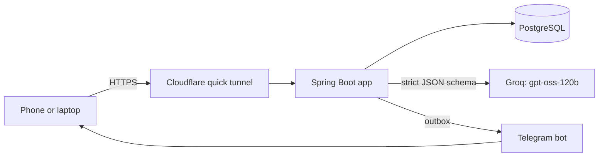
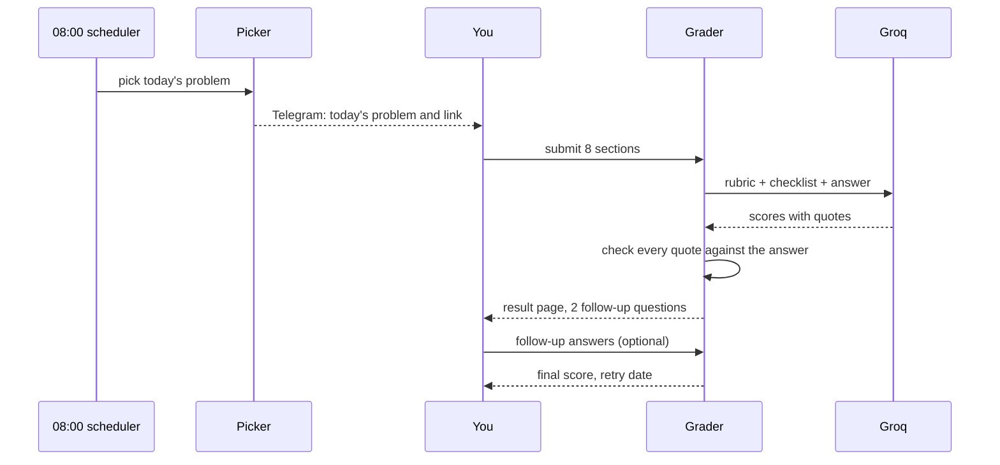

# System Design Drill

A daily system design practice app. Every morning it picks one problem, you write a structured answer against a 45-minute timer, and an LLM grades it against a fixed rubric and a hidden checklist of key points. Weak topics and low scores come back as spaced retries.

## Stack

Java 25, Spring Boot 4, PostgreSQL 17, Flyway, Spring Security, Thymeleaf, htmx, Mermaid, Groq, Telegram Bot API, Docker Compose, Cloudflare Tunnel, Testcontainers, WireMock, Playwright.

## How it works



| Package | What it does |
|---|---|
| `problem` | 30 problems with hidden checklists, loaded from YAML at start-up |
| `drill` | Daily pick: due retries first, then the weakest topic at a difficulty that follows recent scores |
| `answer` | Eight-section editor with autosave, timer and Mermaid preview; submit locks the answer |
| `grading` | Rubric prompt, quote-checked validation, background worker, follow-up round |
| `llm` | Groq client: strict schema output, retries on 429 and 5xx, timeouts, usage logging |
| `progress` | Spaced retries (3, 10 or 30 days), streak, section trends and topic strength |
| `notify` | Telegram outbox: daily problem, reminder, weekly report, new-address message |



## Run it for real

The `app` profile runs the app, PostgreSQL and a Cloudflare quick tunnel on this machine. The quick tunnel needs no Cloudflare account and gives a free `https://<random>.trycloudflare.com` address. The address changes when the tunnel restarts, so the app asks the tunnel for its current address and sends every new one to Telegram. All three containers restart on their own after a reboot.

```bash
./mvnw verify
docker compose --profile app up -d --build
docker compose logs tunnel | grep trycloudflare
```

`.env` holds `DRILL_USER`, `DRILL_PASSWORD_HASH` (BCrypt, in single quotes because of the `$` signs), `GROQ_API_KEY`, `TELEGRAM_BOT_TOKEN` and `TELEGRAM_CHAT_ID`. PostgreSQL and the app listen only on 127.0.0.1; the tunnel is the only way in from outside. Prometheus metrics are at `/actuator/prometheus` after signing in.

## Run locally

The app has one user. Set the username and a BCrypt hash of the password:

```bash
export DRILL_USER=you
export DRILL_PASSWORD_HASH="$(htpasswd -bnBC 12 '' 'your-password' | tr -d ':\n')"
docker compose up -d
./mvnw spring-boot:run
```

Grading uses Groq (`openai/gpt-oss-120b`). Put the key in `.env` (git-ignored) as `GROQ_API_KEY=...`. Without it the app runs, but grading reports that the key is missing.

Telegram messages (daily problem at 08:05, a reminder at 21:00 if today's drill is not submitted, and a weekly report on Sunday at 20:00) need `TELEGRAM_BOT_TOKEN` and `TELEGRAM_CHAT_ID` in `.env`. Without them nothing is sent. Set `DRILL_APP_URL` to the public address so the links in messages work.

Open http://localhost:8080 and sign in. Set `DRILL_SECURE_COOKIE=true` when the app is served over HTTPS.

## Test

```bash
./mvnw verify
```

Unit tests run with Surefire. Integration tests (`*IT`) run with Failsafe against a real PostgreSQL container, so Docker must be running. `EditorUiIT` drives the editor in headless Chromium with Playwright, which downloads the browser on its first run. `LlmClientImplTest` runs the Groq client against WireMock. `LlmLiveSmokeIT` makes one real call and runs only when `GROQ_API_KEY` is set:

```bash
set -a; source .env; set +a
./mvnw verify -Dtest=none -Dsurefire.failIfNoSpecifiedTests=false -Dit.test=LlmLiveSmokeIT
```

## Grader eval

`src/test/resources/grader-eval` holds 12 hand-written answers: a strong, an average and a weak one for four problems. The eval grades each answer twice with the real model and checks that the mean lands in its band and that two runs differ by at most 1 point on any section. It needs `GROQ_API_KEY`, uses about 75K tokens, and paces itself to the free tier's 8K tokens a minute, so it takes about 12 minutes. It never runs in CI.

```bash
set -a; source .env; set +a
./mvnw verify -Pgrader-eval -Dtest=none -Dsurefire.failIfNoSpecifiedTests=false
```

Add `-Deval.runs=1` for a quicker single pass, or `-Deval.cases=average` to run only matching answers. The report is written to `target/grader-eval/report.md`.

Latest result (2026-11-27, `openai/gpt-oss-120b`, reasoning effort `low`): 12 of 12 in band, largest difference between runs on one section 1. Section scores are listed in rubric order, from requirements to trade-offs.

| Answer | Band | Scores | Mean | In band | Section scores | Max section difference | Unverified quotes |
|---|---|---|---|---|---|---|---|
| chat-service/average | 35-64 | 40 / 40 | 40 | yes | 22222111 / 22222111 | 0 | 0 |
| chat-service/strong | 75-100 | 100 / 100 | 100 | yes | 44444444 / 44444444 | 0 | 2 |
| chat-service/weak | 0-34 | 16 / 16 | 16 | yes | 10111010 / 10111010 | 0 | 0 |
| payment-ledger/average | 35-64 | 46 / 44 | 45 | yes | 22222122 / 21222122 | 1 | 1 |
| payment-ledger/strong | 75-100 | 98 / 98 | 98 | yes | 44344444 / 44344444 | 0 | 3 |
| payment-ledger/weak | 0-34 | 20 / 20 | 20 | yes | 10111101 / 10111101 | 0 | 0 |
| rate-limiter/average | 35-64 | 39 / 39 | 39 | yes | 21122211 / 21122211 | 0 | 0 |
| rate-limiter/strong | 75-100 | 100 / 97 | 98 | yes | 44444444 / 34444444 | 1 | 0 |
| rate-limiter/weak | 0-34 | 24 / 24 | 24 | yes | 10022101 / 10022101 | 0 | 0 |
| url-shortener/average | 35-64 | 50 / 46 | 48 | yes | 22222222 / 22222122 | 1 | 0 |
| url-shortener/strong | 75-100 | 100 / 100 | 100 | yes | 44444444 / 44444444 | 0 | 0 |
| url-shortener/weak | 0-34 | 20 / 20 | 20 | yes | 10111110 / 10111110 | 0 | 0 |

What tuning changed:

- The model sometimes copied the `## section` headings into its quotes, which made correct quotes fail the check. The check now ignores those headings, and the prompt asks for one continuous passage.
- Groq sometimes rejects output that breaks the JSON schema with a 400 `json_validate_failed`. The client now retries that once like a server error instead of failing the grade.
- The 1 and 2 anchors were rewritten: 1 is generic or wrong, 2 is correct and specific but incomplete. An answer that is correct but incomplete in every section therefore scores 50.
- The first bands put "average" at 50 to 74, but the sample average answers mix generic and specific sections and scored 39 to 48 every time. The bands were moved to weak 0 to 34, average 35 to 64 and strong 75 to 100, with gaps so a pass means clear separation.
- Reasoning effort `low` uses about 3K tokens per grade instead of 5K at `medium`, with the same rankings, so it is the default.

